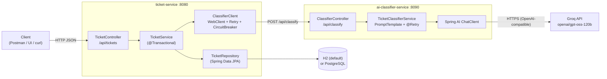
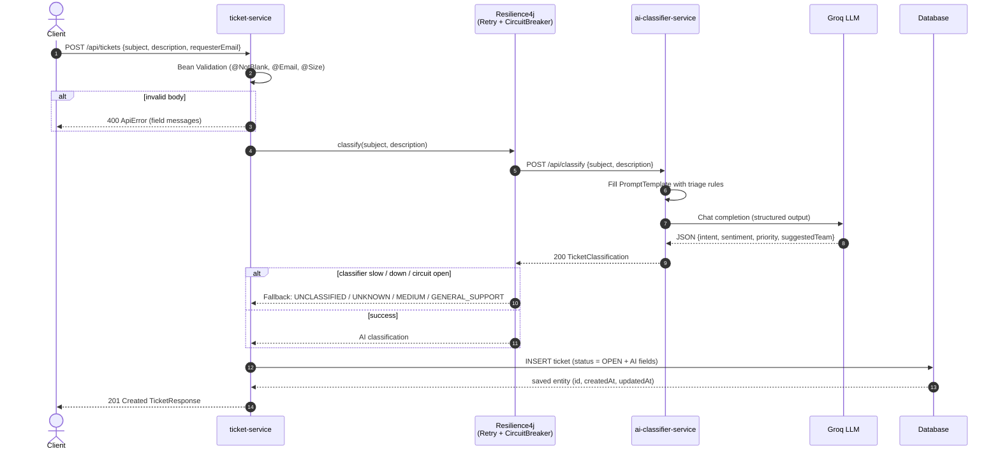

# AI Support Ticket Router — Java Microservices with Spring AI

Two Spring Boot microservices that turn a raw customer support ticket into a triaged ticket. When a ticket is created, an LLM classifies it by **intent**, **sentiment** and **priority**, and suggests which **team** should own it.

- **`ticket-service`** (port `8080`): the public REST API. It creates, reads, lists, updates and deletes tickets, stores them in a database, and asks the classifier to label each new ticket.
- **`ai-classifier-service`** (port `8090`): a small AI service. It sends the ticket text to an LLM (Groq, through Spring AI's OpenAI-compatible client) and returns strongly typed JSON.

The two services talk over HTTP. The call between them is protected by **Resilience4j** (retry and circuit breaker). If the AI is slow or down, the ticket is still created with safe default labels, so the request never fails with a 500.

---

## Architecture



## Data flow: creating a ticket



### How failures are handled

| Layer | Mechanism | Behavior |
|---|---|---|
| ai-classifier → Groq | `@Retry(name = "groq-classify")` | Up to 3 attempts with exponential backoff (500 ms × 2). Connect timeout 3 s, read timeout 8 s. |
| ai-classifier → caller | `AiProviderException` → `GlobalExceptionHandler` | Returns `503 Service Unavailable` with a JSON `ApiError`. |
| ticket-service → ai-classifier | `@CircuitBreaker` + `@Retry(name = "classifier")` | Retries 3 times. The breaker opens when at least 50% of the last 10 calls failed, then waits 15 s before trying again. |
| ticket-service fallback | `classifyFallBack(...)` | The ticket is still created, labelled `UNCLASSIFIED / UNKNOWN / MEDIUM / GENERAL_SUPPORT`. |

---

## Tech stack

| | ticket-service | ai-classifier-service |
|---|---|---|
| Language | Java 17 | Java 17 |
| Framework | Spring Boot 4.1 (Web MVC, Data JPA, Validation, Actuator) | Spring Boot 3.4 (Web, Validation, Actuator) |
| AI | — | Spring AI 1.0.0-M5 (OpenAI starter → Groq) |
| HTTP client | Spring WebFlux `WebClient` | Spring `RestClient` (via Spring AI) |
| Resilience | Resilience4j 2.2 (retry, circuit breaker) | Resilience4j 2.2 (retry) |
| Persistence | H2 in-memory (default), PostgreSQL (profile) | — |
| API docs | springdoc-openapi (Swagger UI) | — |
| Mapping | MapStruct | — |

---

## Project structure

```
.
├── ai-classifier-service/
│   ├── .env.example                 # GROQ_API_KEY=...
│   └── src/main/java/in/ajay/classifier/
│       ├── config/AiClientConfig.java          # HTTP timeouts for Groq
│       ├── controller/ClassifierController.java
│       ├── dto/ClassifyRequest.java, TicketClassification.java
│       ├── exception/                          # ApiError, AiProviderException, handler
│       └── service/TicketClassifierService.java # prompt + structured output
├── ticket-service/
│   └── src/main/java/in/ajay/ticketservice/
│       ├── client/ClassifierClient.java        # WebClient + Resilience4j + fallback
│       ├── config/WebClientConfig.java, OpenApiConfig.java
│       ├── controller/TicketController.java
│       ├── dto/  entity/  mapper/  repository/  service/
│       └── exception/                          # ApiError, 404 / 400 handler
└── Ticket-System.postman_collection.json       # ready-to-import API collection
```

---

## Getting started

### Prerequisites
- JDK 17 or newer
- A free Groq API key from <https://console.groq.com/keys>

### 1. Start the AI Classifier Service (port 8090)

```bash
cd ai-classifier-service
cp .env.example .env          # then put your real key in .env
set -a; source .env; set +a   # export GROQ_API_KEY into the shell
./mvnw spring-boot:run
```

### 2. Start the Ticket Service (port 8080)

```bash
cd ticket-service
./mvnw spring-boot:run
```

By default it uses an in-memory H2 database. To use PostgreSQL instead (`localhost:5432/ticket_db`, user and password `ticket`):

```bash
./mvnw spring-boot:run -Dspring-boot.run.profiles=postgres
```

### Configuration

| Property / env var | Service | Default |
|---|---|---|
| `GROQ_API_KEY` | ai-classifier | — (required) |
| `CLASSIFIER_SERVICE_BASE_URL` | ticket-service | `http://localhost:8090` |
| `app.classifier-service.timeout-ms` | ticket-service | `4000` |

---

## API reference

### ticket-service: `http://localhost:8080`

| Method | Endpoint | Description | Success |
|---|---|---|---|
| `POST` | `/api/tickets` | Create a ticket; it is classified by AI | `201` |
| `GET` | `/api/tickets/{id}` | Get one ticket | `200` / `404` |
| `GET` | `/api/tickets?page=0&size=20&sort=createdAt,desc` | Paged list | `200` |
| `PATCH` | `/api/tickets/{id}/status` | Change status | `200` |
| `DELETE` | `/api/tickets/{id}` | Delete a ticket | `204` |
| `GET` | `/swagger-ui.html` | Swagger UI | |
| `GET` | `/actuator/health` | Health check | |

**Create ticket: request**
```json
{
  "subject": "Charged twice this month",
  "description": "I was billed twice for my subscription in October. Please refund the duplicate charge.",
  "requesterEmail": "customer@example.com"
}
```

**Create ticket: response `201`**
```json
{
  "id": 1,
  "subject": "Charged twice this month",
  "description": "I was billed twice for my subscription in October. Please refund the duplicate charge.",
  "requesterEmail": "customer@example.com",
  "status": "OPEN",
  "priority": "HIGH",
  "sentiment": "NEGATIVE",
  "intent": "BILLING",
  "suggestedTeam": "BILLING_TEAM",
  "createdAt": "2026-11-14T08:07:09.661Z",
  "updatedAt": "2026-11-14T08:07:09.661Z"
}
```

**Update status: request**
```json
{ "status": "IN_PROGRESS" }
```

**Error format (all services)**
```json
{
  "timeStamp": "2026-11-14T08:03:52.779Z",
  "status": 400,
  "message": "subject: Subject must not be blank; requesterEmail: requesterEmail must be a vaild email address",
  "path": "/api/tickets"
}
```

### ai-classifier-service: `http://localhost:8090`

| Method | Endpoint | Description |
|---|---|---|
| `POST` | `/api/classify` | Classify `{subject, description}` and return the four labels |
| `GET` | `/actuator/health` | Health check |

### Classification values

| Field | Allowed values |
|---|---|
| `status` | `OPEN`, `IN_PROGRESS`, `RESOLVED`, `CLOSED` |
| `intent` | `BILLING`, `TECHNICAL_ISSUE`, `ACCOUNT_ACCESS`, `FEATURE_REQUEST`, `GENERAL_INQUIRY` |
| `sentiment` | `POSITIVE`, `NEUTRAL`, `NEGATIVE` |
| `priority` | `LOW`, `MEDIUM`, `HIGH`, `URGENT` |
| `suggestedTeam` | `BILLING_TEAM`, `TECHNICAL_SUPPORT`, `ACCOUNT_MANAGEMENT`, `PRODUCT_TEAM`, `GENERAL_SUPPORT` |

---

## Testing with Postman

Import [`Ticket-System.postman_collection.json`](Ticket-System.postman_collection.json) into Postman. It includes every endpoint above, plus sample 400 and 404 requests. **Create Ticket** saves the new ticket's ID into a collection variable, so Get, Update and Delete then work on that ticket without editing anything.

---

## Learning list

- [**LEARNING_LIST.md**](LEARNING_LIST.md) ([PDF](docs/Combined_Learning_List.pdf)): a combined study guide for both services. It goes file by file in the order a ticket flows through the system, marks interview-favorite topics, and ends with a table of real bugs to fix as exercises.
- [Ticket_Service_Learning_List.pdf](ticket-service/Ticket_Service_Learning_List.pdf): the original ticket-service-only list.

## What this project covers

- Splitting a feature into two independently deployable Spring Boot services
- Spring AI `ChatClient` with a `PromptTemplate` and **structured output** (`.entity(TicketClassification.class)`)
- Using an OpenAI-compatible provider (Groq) by changing only `base-url`
- Service-to-service calls with `WebClient`
- Resilience4j retry, circuit breaker and a fallback that degrades gracefully
- DTOs as Java records, Bean Validation, and one consistent error format through `@RestControllerAdvice`
- Spring Data JPA paging, H2 and PostgreSQL profiles, Actuator health, OpenAPI docs
